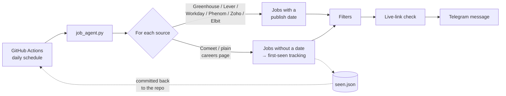

# Jerusalem Job Agent

A scheduled agent that checks the official career sites of Jerusalem tech companies every evening and sends a Telegram summary of newly opened software roles.

It works from primary sources only. Every job in a message comes from the company's own hiring system, is still open, and has a link that was loaded successfully during that run. Nothing in the message is generated, guessed or filled in. When a source can't be checked, the message says so.

---

## Contents

- [How it works](#how-it-works)
- [Design principles](#design-principles)
- [Sources](#sources)
- [Filtering](#filtering)
- [The daily message](#the-daily-message)
- [First-seen tracking](#first-seen-tracking)
- [Setup](#setup)
- [Running locally](#running-locally)
- [Adding a company](#adding-a-company)
- [Project structure](#project-structure)
- [Known limitations](#known-limitations)

---

## How it works



1. GitHub Actions triggers the workflow several times each evening. The first run from 19:00 Israel time sends the update, and daylight-saving time is handled automatically. See [Schedule](#3-schedule).
2. Each source is read through the same channel its own careers page uses: a public job-board API, the site's search endpoint or the site's job list.
3. Every job passes through the [filters](#filtering).
4. A job that passes is loaded once more. It is included only if its page returns HTTP 200.
5. The message is sent to Telegram, and `seen.json` (the [first-seen](#first-seen-tracking) state) is committed back to the repository.

## Design principles

| Principle | How it is enforced |
|---|---|
| **No fabrication** | The title, company, location, type, date and link are all copied from the source record. Fields that are missing are shown as "not stated" (`לא צוין`). |
| **Primary sources only** | Only the companies' own hiring systems are read. Job aggregators and staffing agencies are never used as a source. |
| **Open jobs only** | A job's link must load during the current run, or the job is left out and reported. |
| **Recent jobs only** | A job is reported when its publish date falls within the last 72 hours. |
| **Failures are visible** | If a source can't be reached or a page comes back empty, the message names it. Nothing fails silently. |
| **Honest dates** | When a source has no publish date, the job goes in a separate section labelled "first seen", never "published". |

## Sources

| Company | System | Publish date | Notes |
|---|---|---|---|
| Mobileye | Lever (EU) | ✅ `createdAt` | |
| Triple Whale | Greenhouse | ✅ `first_published` | |
| Lightricks | Greenhouse | ✅ `first_published` | Board used by careers.lightricks.com |
| IDT | Lever | ✅ `createdAt` | |
| Wellthy | Greenhouse | ✅ `first_published` | |
| Intel | Workday | ✅ `startDate` | Workday often rate-limits GitHub runners (see [limitations](#known-limitations)) |
| MKS Instruments | Workday | ✅ `startDate` | Same as Intel |
| Elbit Systems | Elbit's own job feed | ✅ `openDate` | Filtered by city ID 493, shown on Elbit's pages as "ירושלים והסביבה" |
| Squaretalk | Zoho Recruit | ✅ "Date Opened" | |
| Clarivate (Ex Libris) | Phenom | ✅ `postedDate` | |
| Cross River | Comeet | ❌ first-seen | |
| Fullpath | Comeet | ❌ first-seen | Company UID taken from fullpath.com/careers |
| Freightos | Comeet | ❌ first-seen | Company UID taken from freightos.com/careers |
| AGAT Software | Plain careers page | ❌ first-seen | |

Companies were found through the [Made in JLM](https://madeinjlm.org/jobs) Jerusalem tech jobs board. That board was used only for discovery and is never read as a source.

## Filtering

A job reaches the message only if it passes all of these checks.

| Filter | Rule |
|---|---|
| **Location** | The location field mentions Jerusalem / ירושלים |
| **Employment type** | Full-time. A job is kept if the source has no type field, and the message says so. |
| **Role** | The title names a software-development role, e.g. Full Stack, Frontend, Backend, Software, Developer, .NET, React, Angular, מפתח, תוכנה |
| **Excluded roles** | Leadership (Lead, Manager, Director, Architect, מנהל, ראש צוות), students and juniors, and domains such as embedded, hardware, firmware, verification, algorithms, C++ |
| **Experience** | A non-senior posting that requires more than 3 years of experience is left out |
| **Senior roles** | Senior / Sr. / בכיר / מנוסה roles are **not dropped**. They are listed in their own section. |
| **Staffing agencies** | Never configured as sources; a blacklist on the employer name adds a safety net |
| **Live link** | The job page must return HTTP 200 during the run |

You can change all of these at the top of `job_agent.py` (`INCLUDE_TITLE`, `EXCLUDE_TITLE`, `SENIOR_TITLE`, `MAX_YEARS_ALLOWED`, `MAX_AGE_HOURS`).

## The daily message

Messages are sent with Telegram HTML formatting. Each job title links to the job page.

```
עדכון משרות · 24.11.2026 19:30

✅ 1 משרות חדשות ב-72 השעות האחרונות:

Full Stack Engineer            ← links to the job
🏢 Example Co
📍 Jerusalem, Israel
💼 Full-time · Hybrid
📅 פורסם: 24.11.2026
🎓 מתוך המודעה: 2+ years of experience with React and Node.js

🆕 משרות שנפתחו מאז הבדיקה הקודמת
(באתר שלהן אין תאריך פרסום, אז מוצג היום שבו הסוכן ראה אותן לראשונה)
...

⭐ משרות Senior (1) · מעל רמת הניסיון שהגדרת
...

—
נבדקו 14 חברות: Mobileye, Triple Whale, ...
⚠️ לא ניתן היה לבדוק: ...
```

(The job above is an illustration of the format, not real data.)

- A line is shown only when the source gives that field. Unknown fields are left out rather than shown as "not stated".
- When the job list lacks a description or employment type, those are read from the job's own page. The page's JSON-LD `JobPosting` is used when it has one.
- The 🎓 line quotes the full sentence from the posting that states the required years of experience. It is never a summary.
- On days with no matching jobs the message still arrives and says so, which shows that the agent ran.

## First-seen tracking

Comeet and plain careers pages don't publish a posting date. Reporting every open job there as "new" would be wrong, so these sources work differently:

- **The first run for a company** records all its current jobs in `seen.json` as `baseline`. They are never reported, and the message says that tracking has started for that company.
- **Later runs** record each job that wasn't there before with the date and time it was first seen. It is reported once, in the "new since last check" section, with the label `נראתה לראשונה` (first seen).
- The workflow commits `seen.json` back to the repository after every scheduled run, so this state carries over between runs.

## Setup

### 1. Telegram bot

1. Create a bot with [@BotFather](https://t.me/BotFather) (`/newbot`) and copy the token.
2. Send any message to your new bot.
3. Get your chat ID, for example from [@userinfobot](https://t.me/userinfobot).

> **Keep the token secret.** If it is ever exposed, run `/revoke` in BotFather and update the secret.

### 2. Repository secrets

In **Settings → Secrets and variables → Actions**, add:

| Secret | Value |
|---|---|
| `TELEGRAM_BOT_TOKEN` | The bot token from BotFather |
| `TELEGRAM_CHAT_ID` | Your Telegram chat ID |

### 3. Schedule

GitHub starts scheduled runs late when it is busy. On 2026-11-24 the runs were about 8 hours late. To cope with this, `.github/workflows/daily.yml` triggers the workflow every 30 minutes from 16:00 to 21:30 UTC.

- **Before 19:00 Israel time**, a run stops right away.
- **The first run from 19:00 Israel time** sends the update and records the date in `seen.json` (`last_sent`).
- **Every later run that day** sees `last_sent` and stops.

So at most one message arrives per evening, usually shortly after 19:00. If GitHub delays every run past 23:30 Israel time, no update is sent that day.

To run the agent on demand, go to **Actions → Daily job update → Run workflow**. A manual run skips the time check, sends a real message, and does not count as the day's scheduled update.

## Running locally

```bash
pip install -r requirements.txt

# Print the message instead of sending it (ignores the time check, does not save state)
python job_agent.py --force --dry

# Look further back than 72 hours, for testing
JOB_AGENT_MAX_AGE_HOURS=336 python job_agent.py --force --dry

# Send a real message looking back 14 days, without touching seen.json
TELEGRAM_BOT_TOKEN=... TELEGRAM_CHAT_ID=... JOB_AGENT_MAX_AGE_HOURS=336 python job_agent.py --force --no-save

# Send a simple test message to Telegram
TELEGRAM_BOT_TOKEN=... TELEGRAM_CHAT_ID=... python job_agent.py --test
```

On GitHub, **Probe career boards** prints a 14-day dry run without sending anything. **Test message (14 days)** sends a real, clearly labelled message looking back 14 days and does not change `seen.json`.

## Adding a company

1. **Find where the jobs come from.** Open the company's careers page with the browser's network tab open. Common signs are `boards-api.greenhouse.io`, `api.lever.co`, `myworkdayjobs.com`, a Comeet `company-uid`, or a JSON feed.
2. **Check it from GitHub.** `probe.py` is a scratch script for this: point it at the candidate endpoint and run the **Probe career boards** workflow. Confirm that the source returns Jerusalem jobs and that it has a real publish-date field.
3. **Add an entry to `SOURCES`** in `job_agent.py` with a comment on how it was verified. For example:

   ```python
   {
       "company": "Example",
       "type": "greenhouse",
       "api": "https://boards-api.greenhouse.io/v1/boards/example/jobs?content=true",
       "careers_page": "https://example.com/careers",
   },
   ```

4. **If the system has no fetcher yet**, write a `fetch_<type>(source)` function that returns the shared job shape (`company`, `title`, `location`, `all_locations`, `commitment`, `workplace`, `created`, `link`, `description`). Register it in `FETCHERS`. Set `created` to `None` only for sources without dates, and add their type to the first-seen branch in `main()`.

Supported types: `greenhouse`, `lever`, `workday`, `phenom`, `zoho`, `elbit`, `comeet`, `html`.

## Project structure

```
.
├── job_agent.py              # sources, fetchers, filters, message, Telegram
├── probe.py                  # scratch script for checking new sources from GitHub
├── seen.json                 # first-seen state (written by the workflow)
├── requirements.txt
└── .github/workflows/
    ├── daily.yml             # scheduled run: sends the message and saves state
    ├── test-message.yml      # manual: real message, 14-day window, state untouched
    └── probe.yml             # manual dry run with a 14-day window; sends nothing
```

## Known limitations

- **Coverage is not complete.** Only companies whose hiring systems have been verified are checked. Many Jerusalem companies post jobs only on LinkedIn or by email, and some have no careers page at all.
- **LinkedIn is not included.** Scraping LinkedIn breaks its terms of service.
- **Workday rate limiting.** Intel and MKS often answer GitHub's shared runners with HTTP 429. The agent retries with back-off, and when that still fails the message lists the company as not checked. Running the agent from a different network would avoid this.
- **Blocked sites are respected.** Sites that deliberately block automated access, such as Rafael with reCAPTCHA and a locked API, are not worked around.
- **Title-based filtering.** Role and seniority filters read the job title, plus the experience requirement when the description has one. A role with an unusual title can be missed. A Jerusalem job can also be missed when the source lists only another city in its location fields.
- **Plain careers pages are fragile.** If AGAT's page layout changes, the agent reports that it found no jobs on the page, so the problem is visible.

## Requirements

- Python 3.12+
- `requests`
